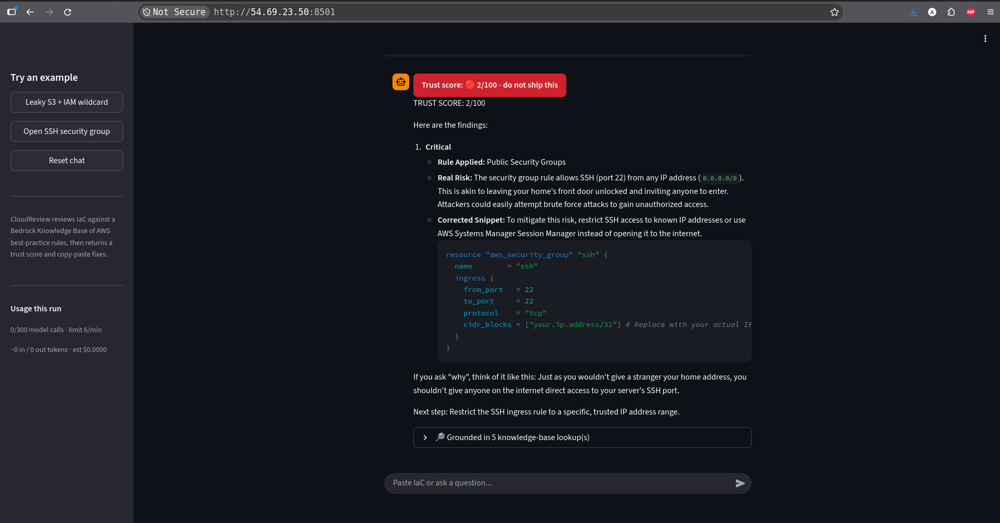

# CloudReview

A small agent that reviews your Infrastructure-as-Code (Terraform, CloudFormation, CDK,
AWS CLI) and tells you, in plain English, **whether it is safe to ship**.

Paste a snippet and it returns:

1. a **TRUST SCORE** out of 100, up front (e.g. "🔴 30/100 - do not ship this"),
2. findings ranked by severity, each explaining the real-world risk with a short story or
   analogy, and
3. a **corrected snippet** you can copy straight back into your code.

Built for people who write a bit of infrastructure but are not security engineers - solo
builders, backend devs who "own a bucket or two", students shipping their first project.



Demo clip: [cloudreview.webm](media/cloudreview.webm)

## How it works

```
Streamlit UI (app.py)
  └─► agent.respond()            # Bedrock Converse tool-use loop (bedrock-runtime)
        └─ tool: search_best_practices(query)
              └─► bedrock-agent-runtime.retrieve(KB)   # grounded in a rules knowledge base
        └─► final answer: "TRUST SCORE: NN/100" + findings + fixes
```

| Piece | What |
|---|---|
| Model | **Amazon Nova Micro** via the **Converse API** (chosen by testing tool-use across the Nova family) |
| Knowledge | **Bedrock Knowledge Bases** over **OpenSearch Serverless**, embedded with **Titan Embeddings V2** |
| Tool | `search_best_practices` → `bedrock-agent-runtime:Retrieve` |
| UI | **Streamlit** with a trust-score badge and a "grounded in N lookups" expander |
| Deploy | **CloudFormation** → free-tier `t3.micro` EC2, app as a systemd service, **IAM instance role** (no static keys) |

## Repo layout

```
agent.py            # model invocation, Converse tool loop, KB retrieval
app.py              # Streamlit UI
kb/                 # scripts + docs to build the Bedrock Knowledge Base
kb/docs/            # the AWS best-practice rulebook that gets indexed
kb/progress.md      # build log (resources, errors, fixes)
ec2/                # CloudFormation stack + generator to deploy on EC2
vercel/             # optional: Vercel Python-function + static UI variant
media/              # demo screenshot and clip
```

## Run locally

Prereqs: AWS credentials with `bedrock:InvokeModel` (Nova Micro) and `bedrock:Retrieve`
on the knowledge base, region `us-west-2`.

```bash
pip install streamlit boto3
streamlit run app.py          # http://localhost:8501
```

Model is swappable without code changes:

```bash
CLOUDREVIEW_MODEL=us.amazon.nova-2-lite-v1:0 streamlit run app.py
```

## Self-check

Runs the agent once on a deliberately-broken snippet and asserts it emits a trust score:

```bash
python3 agent.py
```

## Deploy on AWS (free tier)

```bash
cd ec2 && python3 gen-stack.py
aws cloudformation deploy --stack-name cloudreview --template-file cloudreview.yml \
  --region us-west-2 --capabilities CAPABILITY_NAMED_IAM
aws cloudformation describe-stacks --stack-name cloudreview --region us-west-2 \
  --query 'Stacks[0].Outputs' --output table
```

Tear down:

```bash
aws cloudformation delete-stack --stack-name cloudreview --region us-west-2
```

## Building your own knowledge base

The agent points at a specific knowledge base id (`KB_ID` in `agent.py`). To recreate it:

```bash
cd kb
python3 setup-kb.py      # S3 bucket + OpenSearch Serverless collection + KB + data source
python3 create-index.py  # create the vector index
# upload kb/docs/* to the bucket, start an ingestion job, then:
python3 verify.py        # ingest + retrieval self-check
```

Then update `KB_ID` in `agent.py` (and the KB id in `ec2/gen-stack.py`) to your new one.

## Notes

- The agent caps model calls (6/min, 100/run) to bound cost on a shared link.
- The EC2 stack opens port 8501 publicly for the demo; the IAM role is scoped to Nova
  Micro + this knowledge base only. Take it down when done.
